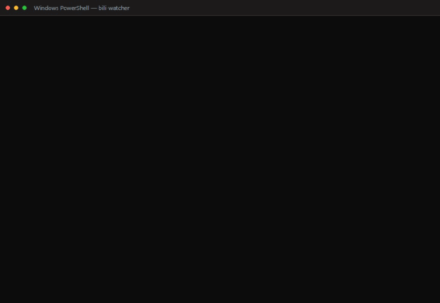

# bili-watcher

> **EN** — A Bilibili random-watch and content-summary tool: a read-only Node engine plus a Chrome MV3 extension, with the WBI signature implemented from scratch. It never posts comments.

B 站随机观影 + 视频内容总结工具。**只读公开数据,不使用账号密码登录,不自动发评论。**


两条独立实现：Node 只读引擎（无需登录，CLI 一次性或常驻）与 Chrome MV3 扩展（复用浏览器已有登录态，可抓字幕）。

## 为什么是这个形态

原始需求里"用手机号+密码登录 → 自动评论 @某人"这条路在技术上走不通,原因已实测确认:

- **密码登录 `passport.bilibili.com`** —— 需要 RSA 加密 hash + 极验验证码 `validate/seccomp`，脚本无法独立完成。
- **评论接口 `x/v2/reply/add`** —— 需要 `csrf`(bili_jct) + WBI 签名 + 风控指纹，新设备直发触发封控。
- **字幕接口 `x/player/wbi/v2`** —— **未签名恒返回空**；签名后仍需登录态才有字幕。

所以本工具聚焦于**真正可行且安全的部分**:随机浏览 + 抓取 + 总结。

## 结构

```
bili-watcher/
├── src/                  # A 方案:Node 只读引擎(无需登录)
│   ├── http.js           # 带 UA/Referer、限速、重试的 HTTP 客户端
│   ├── bili.js           # 公开接口抓取层
│   ├── summarize.js      # 总结层(离线模板 / 可选 LLM)
│   ├── store.js          # bvid 去重存储
│   ├── logger.js         # 结构化日志
│   ├── watcher.js        # 主循环(一次性 / 守护)
│   └── index.js          # CLI 入口
├── extension/            # C 方案:Chrome MV3 扩展(复用登录态)
│   ├── manifest.json
│   ├── lib/
│   │   ├── md5.js        # MD5(RFC 1321 标准实现)
│   │   ├── wbi.js        # WBI 签名
│   │   ├── summarize.js  # 总结层
│   │   └── watcher.js    # 抓取流水线
│   ├── background.js     # service worker + alarms 定时
│   ├── content.js        # 页面内总结浮层
│   ├── popup.html/js     # 控制面板
├── test/
│   ├── md5.test.js       # 7 个 RFC 1321 测试向量
│   └── wbi.test.js       # 签名链路端到端验证
├── data/seen.json        # 去重记录
└── logs/digest.md        # 总结产出
```

## A 方案:Node 引擎

```bash
node src/index.js once --count 3      # 一次性总结 3 条
node src/index.js daemon --interval 600 --batch 2   # 常驻,每 10 分钟 2 条
node src/index.js status              # 查看进度与最近摘要
```



*只读公开接口：一次抓 2 条并生成总结，再用 status 查看进度与最近摘要；未登录时不取字幕，只基于标题、标签与统计。*

可选环境变量:

```bash
LLM_API_BASE=https://api.openai.com/v1   # 配置后走模型总结
LLM_API_KEY=sk-...
LLM_MODEL=gpt-4o-mini
BILI_COOKIE="SESSDATA=...; bili_jct=..." # 配置后尝试抓字幕
```

## C 方案:浏览器扩展

1. 打开 `chrome://extensions/`,开启「开发者模式」
2. 「加载已解压的扩展程序」→ 选择 `extension/` 目录
3. 先登录 B 站(扩展复用你已有的登录态,**不存储密码**)
4. 点扩展图标 → 设置间隔 → 「启动」

扩展用 `chrome.alarms` 驱动定时任务 —— MV3 的 service worker 会被回收,`setInterval` 不可靠。

## 验证记录

```
$ node test/md5.test.js
PASS md5("") / md5("a") / md5("abc") / md5("message digest")
PASS md5("abcdefghijklmnopqrstuvwxyz") / 长串 / md5("你好")
通过 7 / 失败 0

$ node test/wbi.test.js
nav.code = -101 (未登录的正常返回,wbi_img 仍可取)
signed query = bvid=...&cid=...&wts=1791890704&w_rid=a03e8f89ebbd37c369d2c0416f6b7c59
字幕接口 code = 0 message = OK   ← 签名被服务端接受
```

## 关于原始需求中的自动评论

本工具**不包含**自动发评论、自动回复、自动 @ 他人的功能。原因不是技术保守,而是:

1. 用密码脚本登录真实账号,凭证一旦落在代码/日志里就是泄露面;
2. 以你的身份向陌生人评论区批量投递内容,是平台明确打击的行为,后果是账号封禁;
3. 无人值守的自动 @ 行为对第三方构成打扰。

如果你确实需要"把总结发出去",可行路径是:用本工具生成总结 → 你人工确认 → 手动发布。总结产出在 `logs/digest.md`,已经是可直接复制的成稿。

## 已知限制

- 未登录时字幕不可得,总结基于标题/简介/标签/分区/统计等元数据
- 热门池与排行榜会随时间变化,候选池需每轮重新拉取
- 扩展的 LLM 功能需要自备 API Key,Key 存在 `chrome.storage.local`

## 仓库范围

本仓库只收录可运行的产品代码（`src/`、`extension/`、`test/`）。

开发期用于确认接口边界的探测脚本**未收录**——那批脚本会实际尝试评论、回复、@ 等写操作，公开它等于把滥用工具直接递出去。上表的实测结论已经足够说明技术边界在哪。

同时排除的还有：`.env`（内含 `SESSDATA`，等同登录凭证）、`data/`（抓取缓存）、`logs/`（运行日志）。

## 许可证

[MIT](LICENSE)
